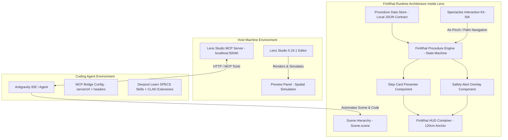

# FixWhat? System Architecture & Technical Specification

**Product Concept:** FixWhat? — “Manual says how. You make it happen.”  
**Target Platform:** Snap Spectacles (SPECS 2024) via Lens Studio 5.24.1  
**Architecture Status:** `PROPOSED` — Baseline Technical Framework for MVP

---

## 1. System Boundary Overview

---

## 2. Runtime Architecture Layers

### Layer 1: Spatial UI & Presentation (Lens API / TypeScript)
- **Focal Plane Management:** Content is parented under a spatial head-following rig (World-locked with smooth rotational lag, or lazy-follow HUD) positioned at `z = -120 cm` (1.2 meters in front of user eye level).
- **Step Card Component (`StepCardPresenter.ts`):**
  - Step counter (`Step 3 of 12`).
  - Action title (`Remove Water Tank Filter`).
  - Concise instructional body text (max 3 lines, high contrast).
  - Tool / Component indicator (`Tool: T20 Torx Driver`).
  - Next/Previous button targets with SIK affordances.
- **Safety Alert Overlay (`SafetyAlertModal.ts`):**
  - High-visibility warning badge (Yellow Caution / Red Danger).
  - Hazard description (e.g. `Caution: Hot Steam Hazard`).
  - Mandatory confirmation button (`I have unplugged the unit`).

### Layer 2: Procedure State Machine (`FixWhatEngine.ts`)
- Manages navigation across procedural steps.
- **States:**
  - `STATE_INIT`: Loading procedure JSON; showing overview and safety pre-flight check.
  - `STATE_STEP_PRECHECK`: Displaying required tools and hazards for the current step.
  - `STATE_STEP_ACTIVE`: Showing step action; awaiting user forward completion.
  - `STATE_STEP_CONFIRM`: Confirming physical check before unlocking next step.
  - `STATE_COMPLETED`: Procedure completion summary, maintenance log.
- **Dual Mode Operation:**
  - **Repair Mode:** Forward-gated progression; mandatory safety barriers; records completed steps.
  - **Training Mode:** Exploratory navigation; permits skipping forward/backward; step practice simulation.

### Layer 3: Procedure Data Contract (Proposed Approach — Pending Milestone 1/2 Review)
- Proposed offline, deterministic JSON representation of equipment manuals pending product and feasibility review.
- Schema components:
  - `manualId`, `equipmentModel`, `title`, `authoritativeSource`.
  - `safetyPrechecks`: Array of pre-repair safety checks (power off, depressurize).
  - `toolsRequired`: Array of tool IDs and names.
  - `steps`: Ordered array of step objects:
    - `stepIndex`, `title`, `description`, `hazardLevel` (`NONE`, `CAUTION`, `DANGER`), `hazardText`, `requiredToolIds`, `spatialAnchorSuggestion`.

---

## 3. Editor API vs. Lens API Separation

As documented in `Support/StudioLib.d.ts` and `Support/editor.d.ts`:

| Dimension | Lens API (`StudioLib.d.ts`) | Editor API (`editor.d.ts`) |
| :--- | :--- | :--- |
| **Execution Realm** | Inside the running Lens at runtime | Inside the Lens Studio editor host |
| **Language** | TypeScript / ES2021 JavaScript | TypeScript via MCP `ExecuteEditorCode` |
| **Usage in FixWhat** | UI components, state machines, SIK interactions | Automated scene construction, asset binding |
| **Coordinates** | Runtime units: cm; Rotation in radians | Editor units: cm; Rotation in degrees |

---

## 4. Technical Unknowns & Spikes

1. **Dynamic OCR Feasibility:** Processing arbitrary real-world PDF manuals on-the-fly via glasses is an unverified backend dependency. **Proposed Approach for MVP (Pending Milestone 1/2 Feasibility Review):** Evaluate using pre-validated structured JSON manual contracts loaded locally into the Lens Studio project to ensure deterministic execution without external latency. The manual-ingestion architecture is not locked and remains subject to formal product review.
2. **Speech Recognition (ASR):** Spectacles ASR requires online network access and specialized permissions. **Proposed Approach for MVP (Pending Milestone 5 Evaluation):** Evaluate using SIK hand interactions (air pinch, palm gesture) as primary reliable input, with voice input treated as an optional progressive enhancement if connectivity and latency permit.
